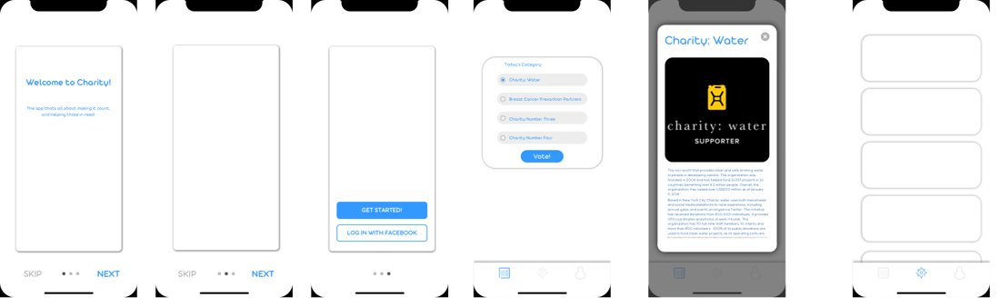

# Charity-App

Charity-App is a design for a mobile app that helps people support charities. Each day the app shows a handful of charities, and users read about them and vote for the one they want to back. This repository holds the UI design only, as a Sketch file. It is not a working app.



## What the design covers

The file `charity.sketch` has one page with eight iPhone-sized artboards (375 x 812):

- **Welcome** and **Welcome-2**: onboarding screens with Skip and Next.
- **Log In**: "Get Started" and "Log in with Facebook" buttons.
- **Poll**: "Today's Category" with four charities to pick from and a Vote button.
- **Poll - Grid**: the same poll as a grid of charity logos.
- **Info Card**: a pop-up with details about a charity (the sample uses Charity: water).
- **Browse**: a list view of charities.
- **Account**: a profile screen with name, email, address and password fields.

## Tech stack

- Sketch (file saved with Sketch 50.2), mockups with placeholder content.
- Fonts used: Aristotelica Text and Aristotelica Display.

## How to open it

A `.sketch` file is a zip archive, so you can look at it without Sketch.

1. Download the repository as a zip, or clone it:
   ```
   git clone https://github.com/maxawad/Charity-App.git
   ```
2. Open `charity.sketch` in [Sketch](https://www.sketch.com/) on macOS. If the Aristotelica fonts are not installed, Sketch will ask you to substitute them.
3. Without Sketch, unzip `charity.sketch`. The folder `previews/` inside contains a rendered overview image, and `images/` contains the pictures used in the design. Tools such as Figma and Lunacy can also import Sketch files.

## Status

Prototype. Design mockups only, with no application code, no build step and no live demo. The project was made in 2018.

## Credits

The charity names, descriptions and logos in the mockups (Charity: water, Breast Cancer Prevention Partners) belong to their owners and are used as sample content only. The text about Charity: water comes from public information about that organization.
